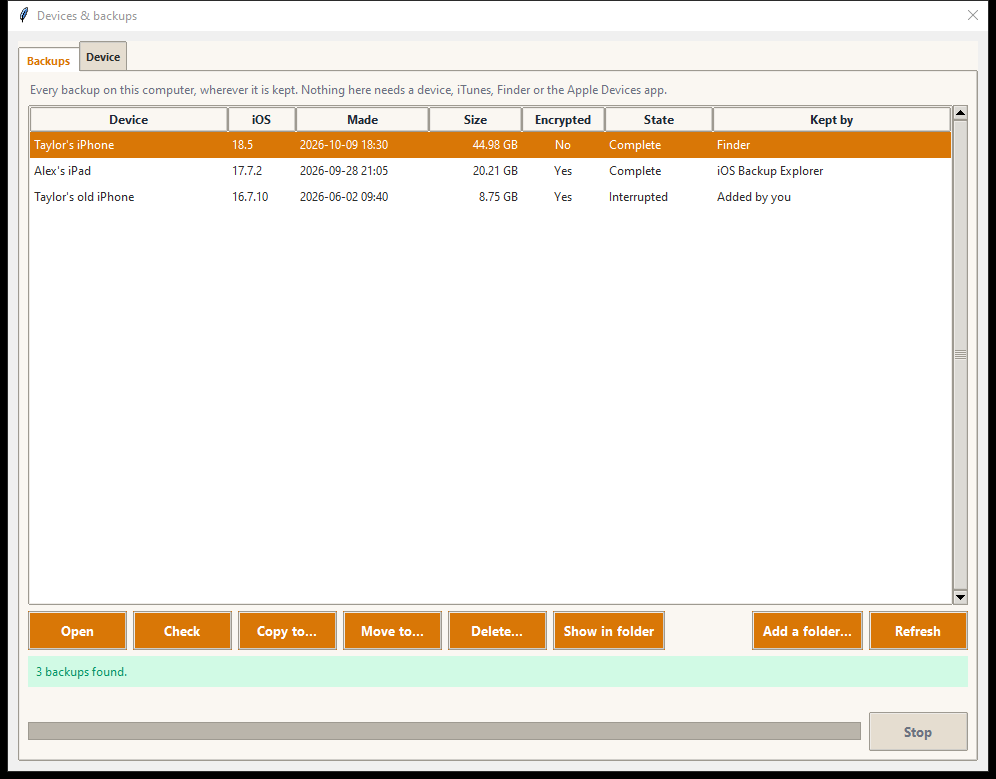
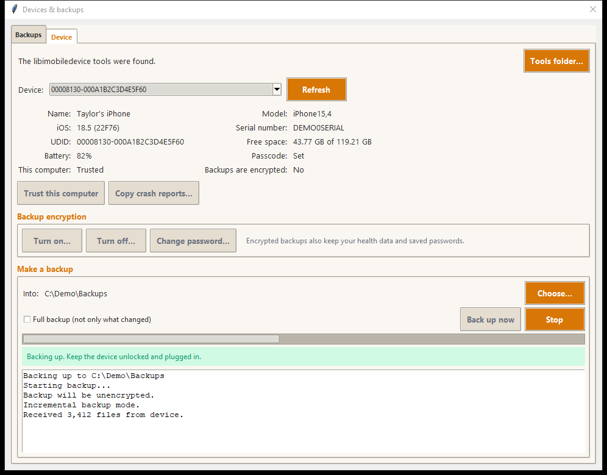

# Devices and backups

Press **Devices & backups...** (next to *Browse...* in the main window) to
manage the backups on your computer and, if you plug a phone or tablet in, to
make a new one. It works the same on **Windows, macOS and Linux**, and it does
not need iTunes, Finder or the Apple Devices app: on Linux, where Apple has
nothing, it is how you pair with a device and back it up.

The window has two tabs.

## The Backups tab

Every backup on the computer, wherever it is kept, in one list: the device it
came from, its iOS version, when it was made, its size, whether it is
encrypted, and whether it finished (a backup that was interrupted says
*Interrupted*). Nothing here needs a device or any extra program.

| System | Where it looks |
|---|---|
| Windows | `%APPDATA%\Apple Computer\MobileSync\Backup` (iTunes), `%USERPROFILE%\Apple\MobileSync\Backup` (Microsoft Store iTunes, Apple Devices app) |
| macOS | `~/Library/Application Support/MobileSync/Backup` (Finder; macOS may ask you to allow access) |
| every system | this program's own folder (on Linux `~/.local/share/ios-backup-explorer/Backups`, which is also where *Back up now* puts a backup unless you choose another), and every folder you add with **Add a folder...** |

What you can do with the one you select (or double-click to open it):

- **Open** opens it in the main window (it asks for the password first if it
  is encrypted).
- **Check** looks that its files are all there. For an unencrypted backup it
  reads the list of files and looks for each one; a missing file is named. A
  difference between a file's size and the size the list gives is *not* called
  a fault, because a phone lists the size a database had before it compacted
  it for the backup. An **encrypted** backup's list cannot be read without the
  password, so only what can be seen is checked (the three property lists, the
  list file, and whether the backup was interrupted), and the report says so.
- **Copy to...** and **Move to...** put the backup in another folder, for
  example on an external drive. The copy is made under a temporary name,
  checked (same files, same total size), and only then renamed, so an
  interrupted copy never looks like a backup. A *move* removes the original
  only after that. Neither ever replaces a backup that is already there, and
  **Stop** removes whatever was copied.
- **Delete...** asks first, names the backup, and says it cannot be undone (it
  does not go to the recycle bin: a backup is often tens of gigabytes). Only a
  folder that is a backup, directly inside a folder this window lists, can be
  deleted, so a wrong path can never reach anything else.
- **Show in folder** opens it in your file manager.

## The Device tab

This tab talks to a device plugged in by its USB cable. It uses
**libimobiledevice**'s command-line tools, which the program never bundles or
downloads (see below); without them the tab says what to install and the rest
of the window still works.

1. **Plug the device in, unlock it**, and press **Refresh**.
2. **Trust this computer** asks the device to trust this computer. Tap
   **Trust** on the device and enter its passcode. (This is what iTunes and
   Finder do the first time too.)
3. The tab then shows what the device says about itself: name, model, iOS
   version and build, serial number, free space, battery, whether a passcode
   is set, and whether its backups are encrypted.
4. **Back up now** makes a backup into the folder shown after *Into:*
   (**Choose...** changes it, and the choice is remembered). By default only
   what changed since the last backup is copied; **Full backup** copies
   everything again. The bar and the log show the progress. **Stop** stops it;
   what was copied is kept and the next backup carries on from it. Keep the
   device unlocked and plugged in until it says it is complete, then **Open**
   it if you like.
5. **Backup encryption** turns the device's backup encryption on (you choose a
   password), turns it off (you give the current one), or changes the password.
   The device may ask for its own passcode to confirm. **Write the password
   down:** if it is forgotten, nobody can open the backups it protects, not
   Apple and not this program (see [Forgot a password?](RECOVERY.md)). An
   encrypted backup also keeps your Health data and saved passwords, which an
   unencrypted one leaves out.
6. **Copy crash reports...** copies the device's crash and diagnostic reports
   into a folder you choose. They stay on the device.

The backups it makes are ordinary backups: the same folder of `Info.plist`,
`Manifest.plist`, `Status.plist` and hashed files named after the device's UDID
that iTunes and Finder make. This program opens them like any other, and so
do Apple's programs if you put one in their folder.

**What it never does:** restore a backup to a device (the one operation that
can destroy what is on the phone; use Apple's software for that), touch
iCloud, or use the network. A device is reached through its USB cable and the
local `usbmuxd` service, and nothing leaves the computer.

### Installing the tools

| System | How |
|---|---|
| Debian, Ubuntu, Linux Mint | `sudo apt install libimobiledevice-utils usbmuxd` |
| Fedora | `sudo dnf install libimobiledevice-utils usbmuxd` |
| Arch, Manjaro | `sudo pacman -S libimobiledevice usbmuxd` |
| openSUSE | `sudo zypper install libimobiledevice-tools usbmuxd` |
| macOS | `brew install libimobiledevice` (Homebrew) |
| Windows | any build of libimobiledevice's tools; if they are not on the `PATH`, use **Tools folder...** to point to the folder that holds `idevicebackup2.exe` and the others. The Apple Mobile Device Service that iTunes or the Apple Devices app installs provides the connection |

The tools used are `idevice_id`, `ideviceinfo`, `idevicepair`,
`idevicebackup2` and `idevicecrashreport`. This program only runs them, as
separate programs (never through a shell), so their licence stays theirs.
Passwords are given to them through their environment, never on a command
line, where other programs of the computer could read them.

### Linux notes

- The `usbmuxd` service must be running (`systemctl status usbmuxd`); the
  packages above start it when a device is plugged in.
- The device must be unlocked and must have been told to **Trust** this
  computer. If *Trust this computer* keeps waiting, unplug the device, plug it
  in again and watch its screen.
- If `idevice_id -l` in a terminal shows nothing, the window will not see the
  device either; fix that first (a different cable or port often does it).
- A package that is older than the device's iOS may not be able to back it up.
  If a backup fails right at the start on a recent iPhone, try a newer
  libimobiledevice (your distribution's newest, or build it from
  [its source](https://github.com/libimobiledevice/libimobiledevice)).
- A program in a sandbox (Flatpak, Snap) may not be allowed to use USB devices.

## What is checked, and what is not

This part is new. It was written against the tools' own source code (what they
print, which options they take, how they take passwords) and tested with
stand-in programs that behave as they do, and the Backups tab, which needs no
device, is tested on invented backups. It has **not** yet been tried on every
iOS version or every device. If something does not work on yours, the exact
error the window shows (and `idevicebackup2 --version`) is the most useful
thing to put in an [issue](HELPING.md); no backup content is needed.

For anything that goes wrong, see [Troubleshooting](TROUBLESHOOTING.md).
