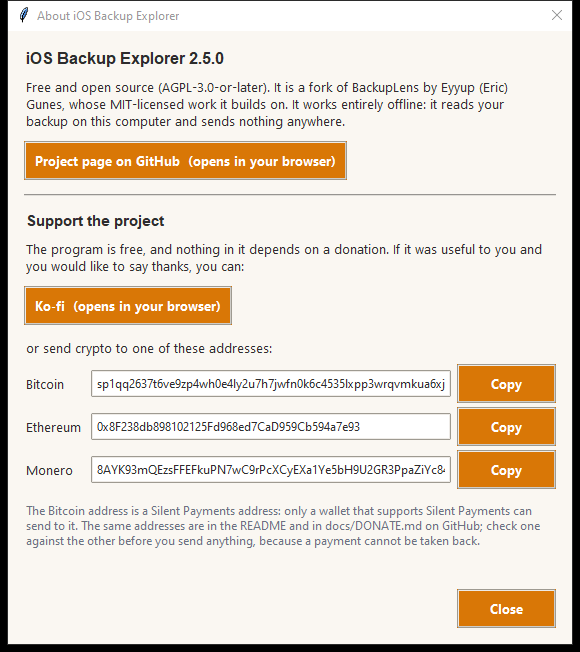

# Supporting the project

iOS Backup Explorer is free and open source, and it stays that way. Nothing
in the program depends on a donation: no feature is locked, nothing is
limited, and the program never asks. The only place it mentions this at all is
a small **About & support** link at the top right of the window (or the
**F1** key), which opens the window in the picture below.

If it was useful to you, you can say thanks if you like. It is entirely
optional, and a star, a good report or a fix is just as welcome (see
[How to help](HELPING.md)).

## Ko-fi

[https://ko-fi.com/scenprogramming](https://ko-fi.com/scenprogramming)

## Crypto

| Coin | Address |
|---|---|
| **Bitcoin** (BTC) | `sp1qq2637t6ve9zp4wh0e4ly2u7h7jwfn0k6c4535lxpp3wrqvmkua6xjqkwevyz0wwqx5ly2f0q29qh48wgf9gl0zt049za9kr9m8xgkey4cyggxa0x` |
| **Ethereum** (ETH) | `0x8F238db898102125Fd968ed7CaD959Cb594a7e93` |
| **Monero** (XMR) | `8AYK93mQEzsFFEFkuPN7wC9rPcXCyEXa1Ye5bH9U2GR3PpaZiYc84SxjMcdSdVMaaQUGmCXYkuxdDSG5bM3EVyqR25nbumV` |

- The **Bitcoin** address is a **Silent Payments** address (BIP 352, it starts
  with `sp1`): only a wallet that supports Silent Payments can send to it. If
  yours cannot, use Ko-fi or one of the others.
- Send only the coin named to its address.

## Before you send anything

- **Check the address.** The same addresses are in the
  [README](../README.md#support-the-project) and in the program's
  **About & support** window. If one differs from another, do not send
  anything, and open an issue.
- **Copy and paste, do not retype.** The window has a *Copy* button for each.
- A cryptocurrency payment cannot be taken back.

## The program stays offline

The program never contacts Ko-fi, a blockchain or anyone else by itself.
Showing the About window opens nothing; the **Ko-fi** and **Project page**
buttons only hand a link to your own browser when you click them. The
addresses above are text, kept in one file (`about.py`) that a test compares
with this page, the README and the repository's sponsor button, so that they
cannot drift apart.
