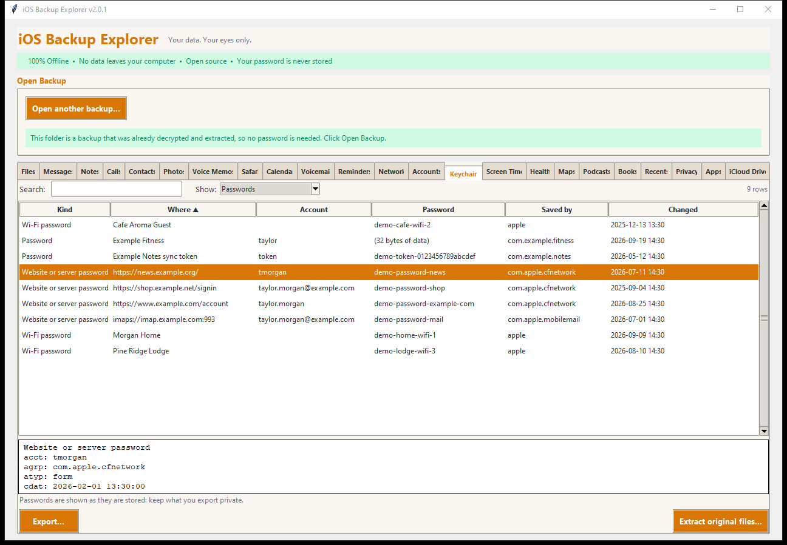
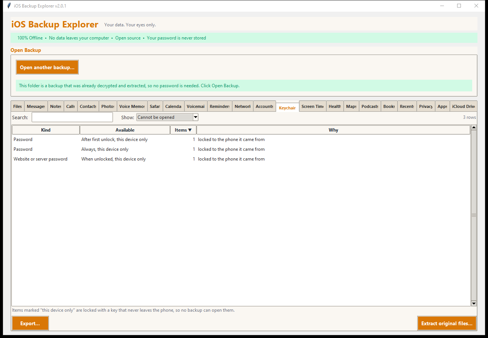

# Keychain

The **Keychain** tab shows the passwords, Wi-Fi passwords, certificates and keys
that the phone kept in its keychain, and put in an **encrypted backup**.

This tab shows your own passwords **in the clear**. Use it on a computer and in
a place you trust, and read [Safety](#safety) below before you export.

## When the tab appears, and what it needs

The tab appears when the backup holds a keychain file
(`KeychainDomain/keychain-backup.plist`). What opens it depends on the backup:

| The backup is | What happens |
|---|---|
| **Encrypted**, opened with its password | The tab opens at once: the keys that came with the password are used. |
| A folder **extracted by this program** (*Extract Entire Backup* from an encrypted backup) | The extraction keeps the backup's *key bag* (see below). The tab asks for the **backup password** the first time, takes a few seconds to unlock, and drops the password. |
| **Unencrypted** | The tab says that the phone leaves saved passwords out of a backup without a password (or locks them to the phone). Make an encrypted backup to see them. |
| A folder extracted **by another tool** | The tab says it cannot open the keychain: the items are locked with keys that only the original backup's key bag holds. Extract again with this program, or open the original encrypted backup. |

### Why extraction keeps a file called `Manifest.plist`

Each keychain item is locked with a key, and those keys are in the backup's
**key bag**, which only the backup password can unlock. The key bag is stored
in the backup's `Manifest.plist`. When *Extract Entire Backup* works on an
encrypted backup it also writes a small `Manifest.plist` into the folder with
just the key bag (still locked by the password; no password or key is written).
That way the extracted folder is complete: open it later in this program, type
the backup password, and the keychain opens. Without that file, the extracted
keychain would be a pile of locked blobs for ever.

(Other programs may treat a folder holding a `Manifest.plist` as a backup. It is
safe to delete the file if you do not need the keychain from that folder.)

## The tables

| Table | What is in it |
|---|---|
| **Passwords** | Saved passwords for websites and servers, the passwords of apps, and **Wi-Fi passwords** (with the network's name). Columns: kind, where, account, password, the app that saved it, when it changed. |
| **Certificates** | Certificates the phone holds. |
| **Keys** | Cryptographic keys. |
| **Cannot be opened** | What could not be opened and why, counted by kind and by when the phone makes it available. |

The details pane shows every stored attribute of the selected item (service,
account, groups, dates, comments...) and, for a value that is not text, its
bytes in hex. Passwords that are text are shown as text.

Items that iCloud Keychain marked as deleted (left over from syncing) are not
listed; the note under the table says how many there were.

### What "this device only" means

Some items are marked *this device only* (for example *After first unlock, this
device only*). The phone locks them with a key that is part of its hardware and
**never leaves it**. A backup holds those items but not the key, so **no
program can open them from a backup**, this one included. They are listed under
*Cannot be opened*, with how many there are. (They can only be restored to the
same phone.) Many of an app's login tokens are of this kind; saved website
passwords and Wi-Fi passwords usually are not.

## Safety

- **Nothing is written to disk in readable form.** The working copy of the
  keychain file in the program's temporary folder is the locked file as it was
  in the backup. The passwords exist, opened, only in the program's memory while
  the backup is open. The backup password is used to unlock the key bag and then
  dropped; it is not stored.
- **Exporting passwords asks first.** *Export...* on the Passwords, Certificates
  or Keys table shows a warning that the files will hold your passwords and keys
  with no protection, and only continues if you agree. Keep such files in a
  folder you trust, and delete them when you are done. The *Cannot be opened*
  table holds no secrets and exports without the warning.
- **Extracting the original file** (*Extract original files...*) copies the
  keychain file exactly as the backup has it: still locked.
- **Nothing leaves your computer.** Like the rest of the program, this tab
  makes no network connection.

## How well this is checked

The format (each item is an AES-GCM-locked record whose key is wrapped with a
class key from the key bag, holding a small DER-encoded set of
name/value pairs) follows the open-source `iphone-dataprotection` tools. In this
project it is tested on keychains **made by this program's own test code**:
the AES-GCM (including the empty nonce the keychain uses) is checked against
`pycryptodome` and a published test vector, the key wrapping against the RFC
3394 vector, the key bag against the decryption library's own, and wrong keys
and damaged items are shown to be refused rather than shown wrong. **It has
not been run on a real keychain**: the real backup used while writing this was
an extraction without its key bag, so its items could not be unlocked. If you open
a real encrypted backup and the tab works (or does not), please
[report it](../../CONTRIBUTING.md#reporting-a-problem) without sending the
contents.

Not covered: very old backups (iOS 4 to 6, keychain format version 0), and
passkeys and the data of iCloud Keychain that never reached the phone.

Source: `KeychainDomain/keychain-backup.plist` and the key bag in `Manifest.plist`.
