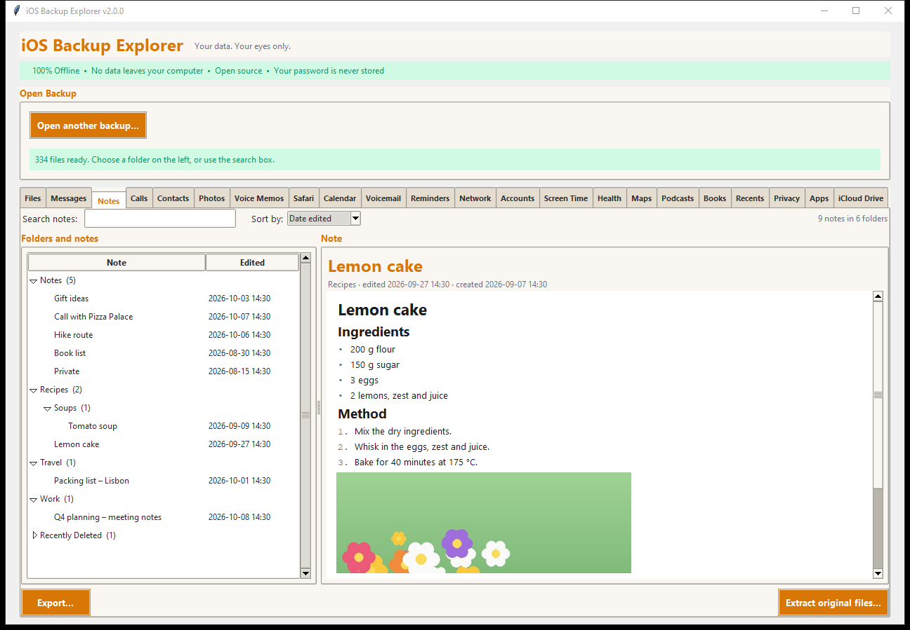
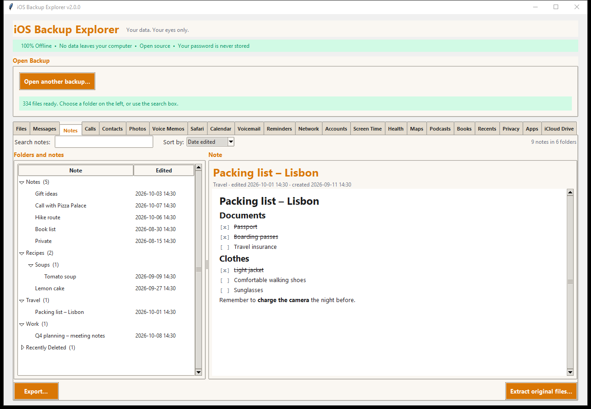

# Notes

The **Notes** tab shows your notes as they look on the phone: formatting,
checklists, pictures, folders and all.

## What you see

- **Folders and notes** (left): the folders with the number of notes in each,
  sub-folders inside them (here *Soups* inside *Recipes*), and *Recently
  Deleted*. Pinned notes come first. **Sort by** *Date edited*, *Date created*
  or *Title*.
- **The note** (right): the title, the folder, when it was edited and created,
  and the note itself.

### Formatting that is shown

Title and headings; bullet, dashed, numbered and **checklist** items (ticked
items are struck through); **bold**, *italic*, underlined and struck-through
text; links; indentation; and the pictures in the note. The look is a close
copy, not an exact one.

### Attachments

- **Pictures** are shown in the note (HEIC pictures need the optional
  `pillow-heif`; see [Installation](../INSTALL.md)).
- **Voice recordings and other attachments** are listed in the note; **click
  one** to open it with your usual program or to save it.
- **Hashtags and link previews** are shown as the text they stand for.

### Call recordings (iOS 18)

A recorded call appears in its note with its title, its length and the
**words Notes wrote down** (the transcript), shown under the recording. In the
backup, a call recording is a movie file (`.mov`) with a *separate track for
each side of the call*. When you open, save, export or extract one you choose:

| Choice | What you get |
|---|---|
| **Mixed audio** | One `.m4a` with both sides together. Made with [ffmpeg](https://ffmpeg.org) from the tracks, so ffmpeg must be installed |
| **Original** | The `.mov` as it is, with the separate tracks |
| **Both** | Both of the above |

The original is never changed.

### Notes that cannot be shown

- A note whose stored text cannot be read is still listed, with a message
  saying so and the short preview iOS keeps, so you know it exists.
- A locked note whose password you do not have (see below), or whose backup
  lacks the details needed to open it, is listed as *(locked)* and shows a
  message instead of its text.

## Locked notes

Notes protected with a password are listed with **(locked)** after their title.
Their text is encrypted in the backup, and only the password you chose in
Notes can open it. (This is the password for locked notes, not the backup
password; different notes can have different passwords.)

- **Click a locked note** and the program asks for its password. The password
  hint you wrote on the phone is shown if there is one. If the password is
  right the note opens, and **every other locked note with the same password
  opens too**, marked **(unlocked)**. If you cancel, the *Unlock this note...*
  button above the note asks again.
- **The password is remembered** while this backup is open, so you are asked
  again only when you click a note locked with a *different* password. A wrong
  password never shows wrong text: the note simply stays locked.
- **Unlock notes...** (bottom of the tab) asks for one password and tries it on
  every locked note at once. **Forget passwords** drops everything that was
  typed and locks the notes again.
- **Searching** looks inside the notes that are open.
- **Exporting** a selection that holds locked notes first tries the passwords
  you already typed. If notes that could be opened are still locked, a window
  lists them (with their hints) and lets you try another password, and another,
  until you have them all or decide what to do with the rest: export
  everything and list the still-locked notes without their text, export
  everything *except* those, or export *only* the locked notes that are open.
  Exported files are ordinary files **without a password**: keep them somewhere
  you trust.

What is **not** done yet: the pictures and files attached to a locked note are
encrypted separately and stay encrypted (the note says how many), and the
program does not guess passwords.

**How well this is checked:** Apple describes the scheme in its Platform
Security Guide (a 16-byte key made from the password with PBKDF2 and SHA-256,
and AES-GCM), and the details used here (a 16-byte salt and the stored
iteration count, an RFC 3394 unwrap of the note's key, the stored nonce and
tag, which table each value is read from) agree with two open-source tools
that are used on real notes: the password-recovery module for Apple Secure
Notes in hashcat, and the Apple Cloud Notes Parser. The tests lock notes with
this program's own test code, so they prove that locking and unlocking agree,
that the key unwrap matches the RFC 3394 test vector, and that a wrong password
can never produce wrong text. **They are not a test against a real locked
note**, because the backup this was written against held none, and a few things
are untested: notes edited on the phone but not yet synced keep their lock
details elsewhere (in `ZUNAPPLIEDENCRYPTEDRECORD`), which is not read. If you
open a locked note of your own and it works (or does not), please
[report it](../../CONTRIBUTING.md#reporting-a-problem) without sending the
note.

## Searching

**Search notes** looks in titles and in the text, and also in hashtags and link
titles. The results appear in the list on the left.

## Exporting

**Export...** exports one note, a whole folder (with its sub-folders) or
everything. The output follows your Notes folders:

| Format | Notes |
|---|---|
| Text | Plain text |
| Markdown | Headings, lists, checklists (`- [x]`), bold and italic kept |
| Web page | With the pictures beside it; HEIC pictures are converted to JPEG when Pillow and pillow-heif are installed. No scripts, and links are only clickable if they are web, mail or phone links |
| PDF | Needs the optional `fpdf2` |
| JSON | Everything about each note, as data |
| Spreadsheet (CSV) | One row for each note |

**Extract original files...** copies the Notes database (with its recent-
changes files) and the media, exactly as the backup holds them.

## Source

`AppDomainGroup-group.com.apple.notes/NoteStore.sqlite` and its `Accounts/`
media folders. The older layout (`HomeDomain/Library/Notes/notes.sqlite`) is not read
(see [Where the data comes from](../DATA_SOURCES.md)).
